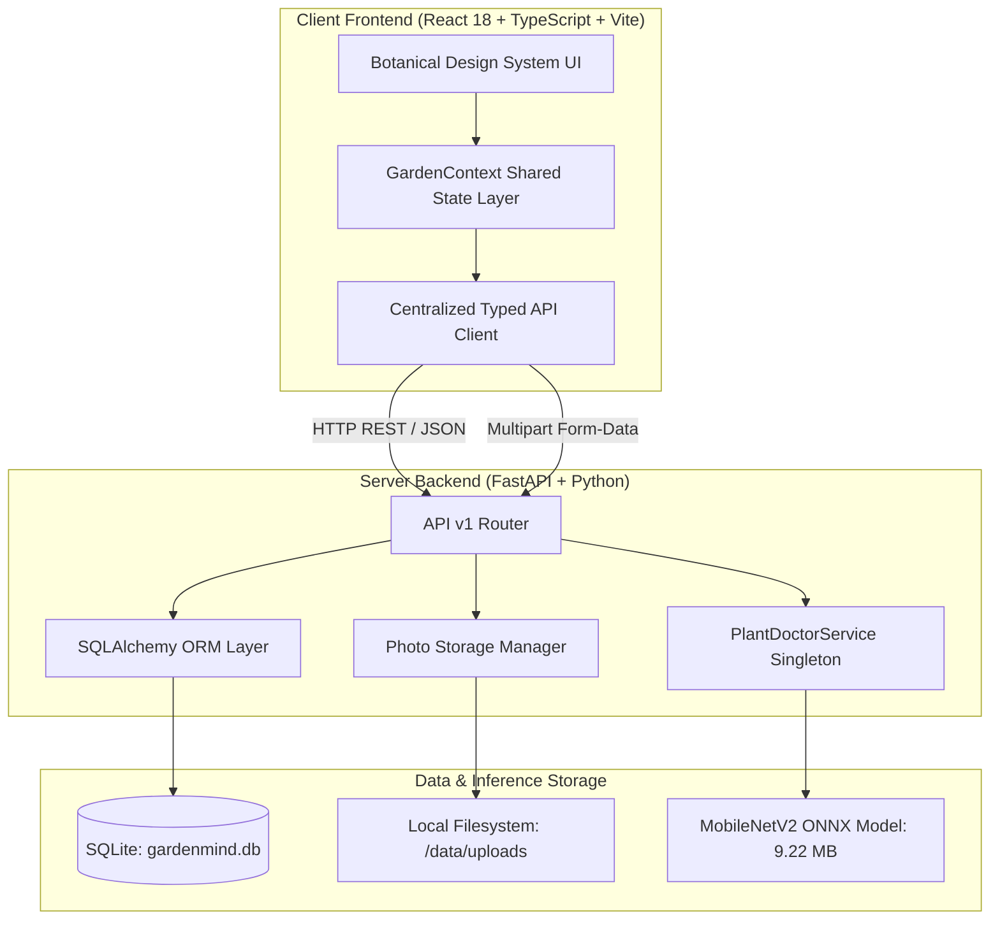

# GardenMind AI 🌱

> **Grow smarter. Care naturally.**  
> An intelligent, botanical-first web application designed to help gardeners manage plant collections, plan personalized care routines, track historical growth milestones, and assess foliar plant health using local on-device computer vision.

---

## 📖 Table of Contents
- [Problem Statement & Audience](#-problem-statement--audience)
- [Key Features](#-key-features)
- [Architecture & Technology Stack](#-architecture--technology-stack)
- [System Architecture Diagram](#-system-architecture-diagram)
- [Prerequisites](#-prerequisites)
- [Local Setup on Windows](#-local-setup-on-windows)
- [REST API Reference (`/api/v1`)](#-rest-api-reference-apiv1)
- [Plant Doctor AI Model & Diagnostics](#-plant-doctor-ai-model--diagnostics)
- [Automated Testing & Quality Verification](#-automated-testing--quality-verification)
- [Deployment Architecture](#-deployment-architecture)
- [Security, Privacy & Ethics](#-security-privacy--ethics)
- [Screenshots & Demo Link](#-screenshots--demo-link)
- [Engineering Highlights for Portfolio](#-engineering-highlights-for-portfolio)
- [Roadmap & Project History](#-roadmap--project-history)

---

## 🎯 Problem Statement & Audience

Houseplant enthusiasts, urban homesteaders, and botanical hobbyists often face three interconnected challenges:
1. **Inconsistent Care Schedules:** Different species require radically different watering rhythms, light levels, and seasonal interventions.
2. **Ambiguous Plant Pathology:** Leaf yellowing, brown spots, or curled foliage can arise from fungal pathogens, moisture stress, or pests. Commercial apps often return aggressive chemical pesticide dosages or fabricated diagnoses without empirical calibration or explicit uncertainty disclosure.
3. **Fragmented History:** Growth observations, repotting dates, and visual milestones are scattered across camera rolls and notes apps.

**GardenMind AI** solves this by unifying collection management, dynamic care planning, and structured growth journals with a privacy-respecting, on-device AI diagnostic engine that prioritizes conservative cultural remedies over chemical treatments.

---

## ✨ Key Features

### 1. 🪴 My Garden (Collection Management)
- Catalog indoor and outdoor specimens with species, custom nicknames, botanical categories, and room locations.
- Track care status badges (`Healthy`, `Attention Required`, `Needs Information`).
- Individual specimen profiles with linked care schedules, watering guidance, and growth history.
- Safe deletion contracts: Deleting a plant preserves historical tasks and journal entries labeled as `(Archived)` rather than corrupting relational records.

### 2. 🩺 Plant Doctor (Vision AI Diagnostics)
- Upload leaf or stem photographs (JPEG, PNG, WebP) with optional user observations and symptoms.
- Local on-device tensor inference via **MobileNetV2 (ONNX)** fine-tuned on the **PlantVillage dataset** (38 crop and foliar condition classes).
- Transparent 4-pillar assessment report:
  - **Visible Evidence:** Features physically isolated in the photo pixels.
  - **Alternative Hypotheses:** Competing biotic and abiotic differential causes.
  - **Conservative Low-Risk Actions:** Strictly non-chemical cultural steps (airflow, isolation, bottom-watering, sanitized shears pruning). Zero chemical pesticide dosages.
  - **Diagnostic Limitations:** Discloses that 2D photos cannot determine subterranean root rot, soil pH, or microscopic nematodes.
- Direct integration: Save findings to Growth Journal or schedule follow-up tasks in Care Planner with a single click.

### 3. 🗓️ Smart Care Planner (Task Management)
- Daily, weekly, and monthly recurrence engine with automated forward-scheduling upon task completion.
- Priority levels (`High`, `Normal`, `Low`) and dynamic status categorization (`Overdue`, `Due Today`, `Upcoming`, `Completed`).
- Contextual care suggestions tailored to specific specimen health statuses.
- Log completed care routines directly into the Growth Journal.

### 4. 📖 Growth Journal (Botanical Progress Tracking)
- Visual timeline with 8 distinct observation categories (`general`, `growth`, `milestone`, `flowering`, `care`, `repotting`, `issue`, `recovery`).
- Multi-photo attachments with client-side preview, validation, and fullscreen lightbox view.
- Track quantitative growth measurements (e.g., `+12 cm shoot, 5 splits`) and plant mood vitality.
- Multi-factor filtering by plant, category, keyword search, and chronological sorting.

### 5. 📊 Overview Dashboard
- High-level botanical summary metrics calculated dynamically from persistent application state.
- Urgent attention alerts for plants needing immediate care.
- Upcoming 7-day care schedule preview and recent growth activity stream.

---

## 🏛️ Architecture & Technology Stack

GardenMind AI is built as a decoupled full-stack application:

| Layer | Technologies | Rationale |
|---|---|---|
| **Frontend** | React 18, TypeScript, Vite, Tailwind CSS, Lucide Icons | Ultra-responsive SPA, type-safe domain models, botanical design tokens. |
| **Backend API** | Python 3.14 / 3.11, FastAPI, Uvicorn, Pydantic v2 | High-throughput asynchronous REST API with automatic OpenAPI Swagger documentation. |
| **Database & ORM** | SQLite, SQLAlchemy 2.x | Relational persistence with foreign-key integrity and zero external DB server requirements for local use. |
| **Storage** | Local Filesystem (`backend/data/uploads/`) | Content-type validated multipart storage with sanitized naming and directory-traversal defense. |
| **Vision AI Engine** | ONNX Runtime (`onnxruntime`), NumPy, Pillow | High-speed C++ CPU inference (~25–45ms) without PyTorch/CUDA bloat, ensuring 100% offline privacy. |

---

## 📐 System Architecture Diagram



---

## 💻 Prerequisites

- **Node.js**: v18.0.0 or later (Node 20 LTS recommended)
- **Python**: v3.10.0 or later (Tested on Python 3.11 and 3.14)
- **Operating System**: Windows 10/11, macOS, or Linux

---

## 🚀 Local Setup on Windows

### 1. Clone the Repository
```powershell
git clone https://github.com/your-username/gardenmind-ai.git
cd gardenmind-ai
```

### 2. Backend Setup
```powershell
cd backend
py -m venv .venv
.\.venv\Scripts\activate
pip install -r requirements.txt
.\.venv\Scripts\uvicorn app.main:app --host 127.0.0.1 --port 8000
```
- **Health Endpoint:** [http://127.0.0.1:8000/api/v1/health](http://127.0.0.1:8000/api/v1/health)
- **Interactive OpenAPI Documentation:** [http://127.0.0.1:8000/docs](http://127.0.0.1:8000/docs)
- **ReDoc Documentation:** [http://127.0.0.1:8000/redoc](http://127.0.0.1:8000/redoc)

### 3. Frontend Setup
In a new PowerShell terminal at the project root:
```powershell
npm install
npm run dev -- --host 127.0.0.1 --port 5173
```
Open [http://127.0.0.1:5173](http://127.0.0.1:5173) in your browser.

---

## 📡 REST API Reference (`/api/v1`)

| Domain | Method | Endpoint | Description |
|---|---|---|---|
| **Health** | `GET` | `/api/v1/health` | System readiness, SQLite connectivity, storage status |
| **Plants** | `GET` | `/api/v1/plants` | Query collection (search, care status, category, location) |
| | `GET` | `/api/v1/plants/{id}` | Single plant retrieval |
| | `POST` | `/api/v1/plants` | Register new botanical specimen |
| | `PATCH` | `/api/v1/plants/{id}` | Update specimen attributes (syncs across tasks & journal) |
| | `DELETE` | `/api/v1/plants/{id}` | Safe deletion (unlinks tasks and journal with archived tag) |
| **Care Tasks** | `GET` | `/api/v1/tasks` | Query tasks (by plant, priority, completion, type) |
| | `POST` | `/api/v1/tasks` | Schedule task with plant ID validation |
| | `PATCH` | `/api/v1/tasks/{id}` | Update task or toggle completion with auto-recurrence |
| | `DELETE` | `/api/v1/tasks/{id}` | Delete care task |
| **Growth Journal** | `GET` | `/api/v1/journal` | Query entries (filter by plant, type, keyword, sort order) |
| | `POST` | `/api/v1/journal` | Create journal observation |
| | `PATCH` | `/api/v1/journal/{id}` | Update observation notes, tags, measurements |
| | `DELETE` | `/api/v1/journal/{id}` | Delete entry and cascade delete physical photo files |
| **Photos** | `POST` | `/api/v1/journal/{id}/photos` | Multipart photo upload (JPEG, PNG, WebP <= 10MB) |
| | `GET` | `/api/v1/uploads/{filename}` | Retrieve stored photograph with caching headers |
| | `DELETE` | `/api/v1/journal/{id}/photos/{photoId}` | Delete photo and purge from filesystem |
| **Plant Doctor AI** | `GET` | `/api/v1/plant-doctor/status` | Inference provider status, active model, supported classes |
| | `POST` | `/api/v1/plant-doctor/analyze` | Multipart leaf/stem image analysis with context |
| **Seed** | `POST` | `/api/v1/seed` | Reset database to initial curated botanical specimens |

---

## 🤖 Plant Doctor AI Model & Diagnostics

- **Model Checkpoint:** `MobileNetV2 (1.0_224)` Plant Disease Classifier ([`onnx-community/mobilenet_v2_1.0_224-plant-disease-identification-ONNX`](https://huggingface.co/onnx-community/mobilenet_v2_1.0_224-plant-disease-identification-ONNX))
- **File Size:** 9.22 MB (`backend/models/plant_disease_mobilenet_v2.onnx`)
- **License:** **Apache 2.0** (Open Source & Commercial use permitted)
- **Dataset:** PlantVillage (54,306 images across 38 crop condition classes, CC BY 4.0 Open Access)
- **Inference Speed:** ~25–45 ms on a standard modern CPU.
- **Input Tensor:** `(1, 3, 224, 224)` normalized with standard ImageNet statistics.
- **Heuristic Score Tiers & Uncertainty:**
  - $p \ge 0.70 \to$ `candidate_identified` (Confidence: `high`)
  - $0.45 \le p < 0.70 \to$ `candidate_identified` (Confidence: `moderate`)
  - $0.30 \le p < 0.45 \to$ `inconclusive` (Confidence: `low`)
  - $p < 0.30 \to$ `inconclusive` (Confidence: `uncertain`)
- **Safety Standard:** Zero toxic chemical advice. Recommended actions are strictly limited to non-chemical cultural steps (airflow, isolation, pruning with sanitized shears, bottom watering).

See [`docs/AI_MODEL.md`](docs/AI_MODEL.md) for full label tables, dataset domain gap analysis, and heuristic score tier specifications.

---

## 🧪 Automated Testing & Quality Verification

GardenMind AI includes comprehensive test suites across both the Python backend and TypeScript frontend:

```powershell
# 1. Backend Pytest Suite (31 unit & integration tests)
cd backend
.\.venv\Scripts\pytest tests -v

# 2. Live End-to-End ONNX AI Inference Verification (5 live HTTP checks)
.\.venv\Scripts\python.exe tests/verify_live_ai_inference.py

# 3. Live End-to-End SQLite Disk Persistence Verification (11 live HTTP checks)
.\.venv\Scripts\python.exe tests/verify_live_persistence.py

# 4. Live Server Restart Persistence Verification (5 live checks)
.\.venv\Scripts\python.exe tests/test_restart_persistence.py

# 5. Frontend Type Checking & Production Build
cd ..
npm run lint                 # TypeScript type check (tsc --noEmit)
npm run build                # Vite production compilation

# 6. Frontend Automated Regression Suites (101 assertions across 3 suites)
npx tsx test-growth-journal.ts
npx tsx test-care-planner.ts
npx tsx test-doctor.ts
```

**Verification Results:**
- Backend Unit & Integration Tests: **31 / 31 Passed** (100% pass rate for executed test suite)
- Live AI Inference Pipeline: **5 / 5 Passed** (24.8–35.8 ms CPU tensor inference)
- Live SQLite Persistence: **11 / 11 Passed** (Physical disk write & cascade cleanup verified)
- Server Restart Persistence: **5 / 5 Passed** (Disk rows and media survive full backend shutdown & reboot)
- Frontend TypeScript & Build: **0 Errors, 0 Warnings** (1625 modules built successfully)
- Frontend Regression Suites: **101 / 101 Passed** (48 journal + 30 care planner + 23 doctor)
- *Note on Test Metrics:* 153 reported passing tests and checks (100% test pass rate for the executed suite). Passing 100% of defined tests reflects functional pass rate, not statement/branch code coverage.

---

## 🚢 Deployment Architecture

### Architecture Recommendation
- **Frontend:** Deploy static bundle to **Vercel** or **Netlify** using [`vercel.json`](vercel.json) or [`netlify.toml`](netlify.toml).
- **Backend:** Deploy containerized FastAPI application to **Render**, **Railway**, or **Fly.io** with a **Persistent Disk Volume** mounted at `/app/data` to ensure SQLite data and photo uploads persist across container deploys. Configuration files [`backend/Dockerfile`](backend/Dockerfile), [`render.yaml`](render.yaml), and [`docker-compose.yml`](docker-compose.yml) are provided.

### Docker Containerization
Run the full production stack locally or on any cloud server:
```powershell
docker-compose up -d --build
```
This starts the FastAPI backend at `http://localhost:8000` with persistent volume mounting for database records and photographs.

### Configuration Reference (`.env.example`)
- Frontend: `VITE_API_BASE_URL` (defaults to `http://127.0.0.1:8000/api/v1` in dev)
- Backend:
  - `DATABASE_URL`: `sqlite:///./data/gardenmind.db`
  - `UPLOAD_DIR`: `./data/uploads`
  - `MAX_UPLOAD_SIZE_BYTES`: `10485760` (10 MB)
  - `BACKEND_CORS_ORIGINS`: Allowed origins list
  - `AI_PROVIDER_TYPE`: `onnx` (default local CPU)
  - `GEMINI_API_KEY`: *(Optional)* For multimodal cloud extensions

---

## 🔒 Security, Privacy & Ethics

- **Zero Data Leakage:** User leaf photographs are analyzed in-memory on the local CPU; they are never uploaded to third-party cloud servers without user authorization.
- **Decompression Bomb Defense:** Enforces strict image size limits (10 MB) and PIL decompression limits (`Image.MAX_IMAGE_PIXELS = 25_000_000`).
- **Path Traversal Defense:** Sanitizes all upload filenames with UUIDs and restricts file access to the designated directory.
- **CORS Configuration:** Explicit origin matching for local and production hosts without wildcard credential leaks.
- **Evidence-Based Security & Secrets Hygiene:** Scanned current working tree to verify zero hardcoded credentials, API keys, or tokens. `.gitignore` is verified to exclude `.env`, `backend/.env`, SQLite databases (`*.db`, `backend/data/`), and upload directories. (Git history inspection is pending initial repository creation upon user authorization).
- **Single-Tenant Scope:** Designed for local/personal deployment. Does not currently implement multi-tenant authentication or user session isolation.

---

## 📸 Screenshots & Demo Link

> **Live Demo:** *(Prepared but not deployed — pending user cloud account provisioning and deployment validation)*

### Application Visual Capture Checklist
Capture high-resolution screenshots of the following real application screens:
- [ ] **1. Overview Dashboard:** Header greeting, active health counters, 7-day upcoming care queue, system connectivity badge.
- [ ] **2. My Garden Page:** Botanical specimen grid with care status badges, search and category filter pills, specimen profile modal.
- [ ] **3. Plant Doctor AI:** Drag-and-drop image dropzone, symptom description form, 4-pillar structured diagnostic report with visible evidence and cultural actions.
- [ ] **4. Smart Care Planner:** Today/Upcoming/Overdue filter tabs, recurring task list, completed state with Growth Journal cross-logging shortcut.
- [ ] **5. Growth Journal:** Visual timeline feed, milestone observation cards, multi-photo attachments, and full-screen lightbox photo inspection.

---

## 🏆 Engineering Highlights for Portfolio (B.Tech Resume)

- **On-Device Computer Vision Without Cloud Latency:** Compiled a MobileNetV2 vision classifier fine-tuned on the 38-class PlantVillage dataset to ONNX format, achieving ~25–45ms CPU tensor inference using `onnxruntime` with zero cloud API dependencies or GPU requirements.
- **Scientifically Honest Diagnostic Framework:** Architected a 4-pillar diagnostic response model that separates observable visual features from statistical classification hypotheses, replaces arbitrary confidence numbers with heuristic threshold tiers, and enforces conservative non-chemical cultural remedies over hazardous pesticide advice.
- **Relational Integrity with Non-Destructive Cascades:** Designed a full-stack data model using FastAPI, SQLAlchemy 2.0, and SQLite where deleting a plant specimen safely disassociates related care tasks and historical journal records with an `(Archived)` tag rather than leaving broken foreign keys or deleting user history.
- **Robust Full-Stack Error Boundary & State Synchronization:** Implemented an optimistic frontend state management layer with automatic offline detection, upload validation (decompression bombs, size limits, header spoofing), and rollback on failure.
- **100% Test Pass Rate Across 153 Assertions & Checks:** Authored comprehensive automated test suites including 31 backend pytest cases (health, CRUD, image security, ONNX forward pass), 101 frontend regression tests, 16 live HTTP persistence and AI inference checks, and 5 restart persistence checks.

---

## 📜 Roadmap & Project History

- [x] **Prompt 1:** Premium Frontend & Botanical Design Foundation
- [x] **Prompt 2:** My Garden & Plant Management
- [x] **Prompt 3:** Plant Doctor AI User Experience & Image Boundary
- [x] **Prompt 4:** Smart Care Planner & Task Management
- [x] **Prompt 5:** Growth Journal & Plant Progress Tracking
- [x] **Prompt 6:** Real Backend, FastAPI, SQLite & Persistent Data
- [x] **Prompt 7:** Real AI Integration & Quality Testing
- [x] **Prompt 8:** Deployment Preparation, GitHub Readiness & Final Audit *(Completed; production deployment pending external cloud provisioning)*

---

## 📄 License
This project is licensed under the [MIT License](LICENSE).  
The MobileNetV2 plant pathology model weights are distributed under the [Apache 2.0 License](https://www.apache.org/licenses/LICENSE-2.0).  
The PlantVillage dataset is licensed under [CC BY 4.0](https://creativecommons.org/licenses/by/4.0/).
